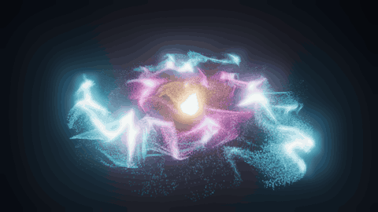
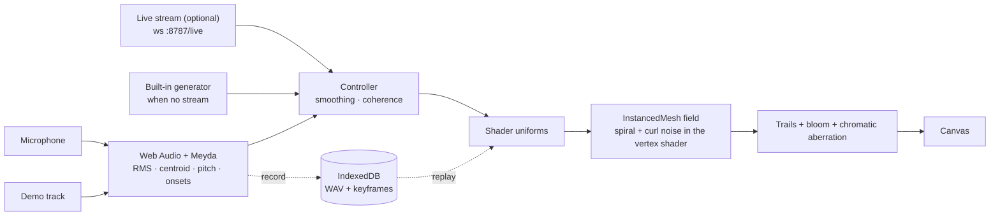

# Voice Garden — audio-reactive particles in your browser

**[▶ Open the live demo](https://lyrapower.github.io/voice-garden/)** · it moves on its own; press **▶ Play demo track** to hear it, or **Mic on** and talk, sing or play music. If it makes you smile, a ⭐ helps other people find it.



```bash
git clone https://github.com/Lyrapower/voice-garden && cd voice-garden
npm install
npm run dev
```

## Why

Most audio visualizers are bars and waveforms. Voice Garden treats sound more like weather: pitch, loudness and rhythm push 50k–200k particles around a slowly turning spiral, a nebula that breathes with the sound. You can orbit it, record it and replay it. It runs entirely in the browser, with no server and no upload.

## Features

- **100k particles in one draw call.** One `InstancedMesh` draws camera-facing quads. The vertex shader lays them out as three logarithmic spiral arms that turn as one pattern while the particles stream inward along them, with curl-noise turbulence on top. Light trails, an Unreal bloom pass and a light chromatic aberration finish the image (WebGL2). Behind it, a night sky (stars, faint nebula, the limb of a planet) is computed once into a texture, no image files; the controls float over it as frosted glass.
- **Colour from the sound.** A deep-space palette (navy, cyan, magenta, gold) runs from the rim to the core and leans warmer as the sound gets brighter (spectral centroid); loudness and onsets push brightness and glow.
- **Moves on its own, plays a demo track, listens to the microphone.** With no input a built-in generator keeps it moving. **▶ Play demo track** plays a 28-second dream-trance loop made entirely from code ([CC0](#license)) through the same analysis, looped sample-exactly with Web Audio. [Meyda](https://meyda.js.org/) extracts loudness (RMS), spectral centroid, dominant frequency and onsets ("beats") from Web Audio; these drive density, flow strength and colour.
- **Record and replay sessions.** A session is saved as mono WAV plus particle keyframes in IndexedDB, on your device only. Replaying drives the field from the recording. **Record session** is in the Garden panel (top right).
- **Live controls.** A settings panel for dispersion, particle size, flow speed, audio reactivity, bloom, colour drift and particle count.
- **Latency overlay.** Shows FPS and the audio-to-visual delay, so you can check the ≤ 80 ms target on your machine.
- **Optional live stream.** It can also follow an external pitch stream over WebSocket or HTTP (see [Configuration](#configuration)).

Want a video instead of a live view? [**voice-garden-render**](https://github.com/Lyrapower/voice-garden-render) renders any audio file into an MP4 of this field, frame by frame, from the command line, in five palettes. It is also an agent skill: `npx skills add Lyrapower/voice-garden-render`, then ask your agent for a music video.

## How it works



`coherence = 1 - min(|voiceFreq - streamFreq|, 8000) / 8000`, clamped to `[0, 1]`, is blended with loudness and drives how tightly the field holds together.

## Configuration

| Setting | Range | Default | What it changes |
| --- | --- | --- | --- |
| dispersion | 0.5–3 | 0.7 | size of the spiral |
| particleSize | 0.5–3 | 0.6 | quad size |
| flowSpeed | 0.1–2 | 1 | how fast the spiral turns and the particles stream |
| audioReactivity | 0–1 | 0.7 | how much the microphone moves the field |
| bloomIntensity | 0–3 | 1 | glow |
| colorShiftSpeed | 0–2 | 1 | colour drift over time |
| particleCount | 50k–200k | 100k | number of particles |

**Live stream.** Under `npm run dev` the field also looks for a server on port 8787: first WebSocket `ws://<host>:8787/live`, then HTTP polling of `/api/telemetry`. Each message is one JSON object:

```json
{ "t": 12.3, "aiFreq": 440, "aiAmplitude": 0.2 }
```

With no server, a built-in generator supplies similar samples at 20 Hz, so the page always works on its own. A built site (`npm run build`, the hosted demo) skips the port 8787 probes; build with `VITE_LIVE=1` or add `?live` to the URL to turn them on.

## Tests

```bash
npm test             # vitest: keyframe interpolation, coherence and controller bounds, WAV encoding, loop points
npm run build        # type-check (strict) and build into dist/
```

## Build and deploy

```bash
npm run build        # dist/ for any static host
npm run build:pages  # dist/ for GitHub Pages under /voice-garden/
npm run zip          # build and pack dist/ into garden-dist.zip
```

Every push to `main` runs the tests and deploys the demo with [`.github/workflows/pages.yml`](.github/workflows/pages.yml).

## Roadmap

- Colour palettes and presets you can share as a link
- MIDI and OSC input alongside the microphone
- A WebGPU compute path for 1M+ particles
- Export a recorded session straight to video (today: [voice-garden-render](https://github.com/Lyrapower/voice-garden-render))

## Contributing

Issues and pull requests are welcome. Issues labelled [`good first issue`](https://github.com/Lyrapower/voice-garden/labels/good%20first%20issue) are small and self-contained; questions and show-and-tell go in [Discussions](https://github.com/Lyrapower/voice-garden/discussions). Please run `npm test` and `npm run build` before opening a pull request.

## License

[MIT](LICENSE). `public/demo-track.mp3` is generated from code by [`scripts/make-demo-track.py`](scripts/make-demo-track.py) (numpy, scipy and ffmpeg, only needed to regenerate it) and is CC0.
